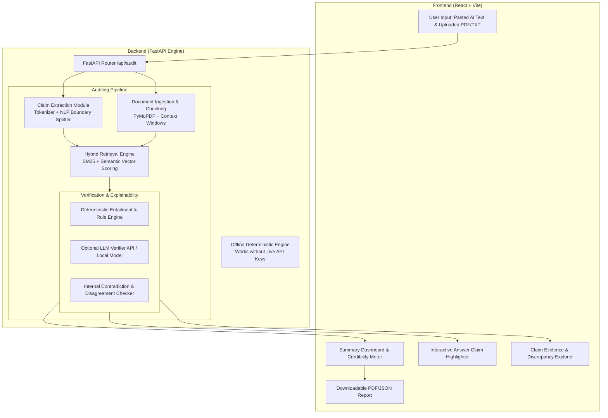

# Project Architecture & Technical Blueprint: Second Opinion

**Second Opinion** is an explainable, claim-level AI Answer Auditor that verifies AI-generated text against reference evidence (documents or web sources) without relying on opaque black-box magic or expensive API dependencies.

---

## 1. System Architecture



---

## 2. Component Breakdown

| Component | Technology | Role & Behavior |
| :--- | :--- | :--- |
| **Claim Extractor** | spaCy / Regex Heuristics / Standard Tokenizer | Decomposes raw AI text into fine-grained atomic factual statements with exact character offsets (`start_char`, `end_char`). |
| **Document Ingester** | PyMuPDF (`fitz`), Text Chunking | Parses PDF pages and raw text into overlapping passages annotated with page numbers, document headers, and line ranges. |
| **Passage Retriever** | `rank_bm25` + TF-IDF / `sentence-transformers` | Finds top-$K$ most relevant passages per claim from uploaded documents. |
| **Web Retriever** *(Optional)* | DuckDuckGo / Wikipedia API | Fetches external web snippets when document context is absent or user enables web verification. |
| **Claim Verifier** | NLI Rules + Keyword Overlap / LLM Prompts | Classifies each claim into: `SUPPORTED`, `CONTRADICTED`, or `INSUFFICIENT_EVIDENCE`. |
| **Discrepancy Analyzer** | Heuristic Graph & Matrix Check | Flags internal contradictions (e.g., Claim 1 contradicts Claim 4 within the same answer) and source disagreement. |
| **Deterministic Fallback** | Pure Python Algorithmic Logic | Guarantees 100% runnable offline execution during hackathon judging even if external AI APIs rate-limit or fail. |

---

## 3. Proposed Repository Structure

```
Second Opinion/
├── backend/
│   ├── app/
│   │   ├── __init__.py
│   │   ├── main.py                  # FastAPI Application Entry
│   │   ├── config.py                # App Configuration & Defaults
│   │   ├── api/
│   │   │   ├── __init__.py
│   │   │   └── routes.py            # /api/audit, /api/health, /api/sample
│   │   ├── core/
│   │   │   ├── __init__.py
│   │   │   ├── extractor.py         # Claim extraction logic
│   │   │   ├── parser.py            # PDF (PyMuPDF) and text document parser
│   │   │   ├── retriever.py         # BM25 & Semantic retriever
│   │   │   ├── verifier.py          # Claim verification & explainability engine
│   │   │   └── fallback.py          # Deterministic offline fallback system
│   │   ├── schemas/
│   │   │   ├── __init__.py
│   │   │   └── audit.py             # Pydantic Request & Response models
│   │   └── tests/
│   │       ├── test_extractor.py
│   │       ├── test_retriever.py
│   │       ├── test_verifier.py
│   │       └── test_integration.py
│   ├── requirements.txt
│   └── run.py
├── frontend/
│   ├── src/
│   │   ├── components/
│   │   │   ├── Header.jsx           # App Navbar & Status
│   │   │   ├── InputSection.jsx     # AI Answer input & Document upload
│   │   │   ├── SummaryDashboard.jsx # Credibility score & breakdown charts
│   │   │   ├── ClaimHighlighter.jsx # Color-coded interactive answer viewer
│   │   │   ├── ClaimCard.jsx        # Individual claim verdict & evidence list
│   │   │   └── EvidenceModal.jsx    # Deep-dive source document context viewer
│   │   ├── services/
│   │   │   └── api.js               # Axios / Fetch client
│   │   ├── App.jsx
│   │   ├── main.jsx
│   │   └── index.css                # Custom CSS Design System
│   ├── package.json
│   └── vite.config.js
└── README.md
```

---

## 4. API Specification

### `POST /api/audit`

#### Request Schema (`AuditRequest`)
```json
{
  "answer_text": "Amoxicillin 50mg should be administered once daily for adult pneumonia.",
  "documents": [
    {
      "filename": "clinical_guidelines.pdf",
      "content": "For adult community-acquired pneumonia, the recommended dosage of Amoxicillin is 500mg to 1000mg orally three times daily for 5-7 days."
    }
  ],
  "options": {
    "enable_web_search": false,
    "force_deterministic_fallback": false,
    "top_k_passages": 3
  }
}
```

#### Response Schema (`AuditResponse`)
```json
{
  "audit_id": "audit_8f92a10c",
  "timestamp": "2026-10-10T15:25:04Z",
  "summary": {
    "total_claims": 1,
    "supported_count": 0,
    "contradicted_count": 1,
    "insufficient_evidence_count": 0,
    "credibility_score": 0.0,
    "internal_contradictions_detected": 0
  },
  "claims": [
    {
      "claim_id": "claim_1",
      "text": "Amoxicillin 50mg should be administered once daily for adult pneumonia.",
      "start_char": 0,
      "end_char": 71,
      "verdict": "CONTRADICTED",
      "confidence": 0.95,
      "explanation": "Reference clinical_guidelines.pdf specifies 500mg-1000mg three times daily, which directly contradicts the claim of 50mg once daily.",
      "evidence": [
        {
          "excerpt": "For adult community-acquired pneumonia, the recommended dosage of Amoxicillin is 500mg to 1000mg orally three times daily for 5-7 days.",
          "source_name": "clinical_guidelines.pdf",
          "page_number": 1,
          "relevance_score": 0.89,
          "match_type": "bm25_passage"
        }
      ],
      "flags": {
        "is_ambiguous": false,
        "source_disagreement": false,
        "internal_contradiction": false
      }
    }
  ]
}
```

---

## 5. 24-Hour Feature Priority Plan

```mermaid
gantt
    title 24-Hour Hackathon Development Timeline
    dateFormat  HH:mm
    axisFormat %H:%M

    section Phase 1: Core Engine
    FastAPI Architecture & Schemas       :active, p1, 00:00, 1h
    Claim Extractor & PDF Ingestion     :p2, 01:00, 1.5h
    BM25 Retriever & Rule Verifier       :p3, 02:30, 1.5h

    section Phase 2: Intelligence & Fallback
    Deterministic Verification Fallback  :p4, 04:00, 1.5h
    Internal Contradiction Detection    :p5, 05:30, 1.5h

    section Phase 3: Web UI
    Vite + React Setup & Custom Styling :p6, 07:00, 2h
    Interactive Answer Claim Highlighter :p7, 09:00, 2.5h
    Evidence Viewer & Metrics Dashboard :p8, 11:30, 2.5h

    section Phase 4: Integrations & Demos
    PDF Upload Drag-and-Drop            :p9, 14:00, 2h
    Pre-loaded Test Benchmarks           :p10, 16:00, 1.5h
    PDF Audit Report Downloader          :p11, 17:30, 2.5h
    Polish, End-to-End Testing & Buffer  :p12, 20:00, 4h
```



---

## 6. First Implementation Milestone & Verification Strategy

### **Milestone 1 Target: Core Verification Engine with Pytest Validation**
1. Initialize FastAPI backend structure with Pydantic schemas.
2. Build `extractor.py` to extract atomic factual sentences with precise character indices.
3. Build `parser.py` supporting text strings and PDF files (via PyMuPDF).
4. Build `retriever.py` utilizing BM25 text passage matching.
5. Build `verifier.py` & `fallback.py` to classify claims deterministically into `SUPPORTED`, `CONTRADICTED`, and `INSUFFICIENT_EVIDENCE`.
6. **Verification Method**: Run automated `pytest` test suite covering:
   - High precision claim boundary extraction.
   - Exact passage retrieval match accuracy.
   - Deterministic verification accuracy on mock medical/legal audit test cases.
